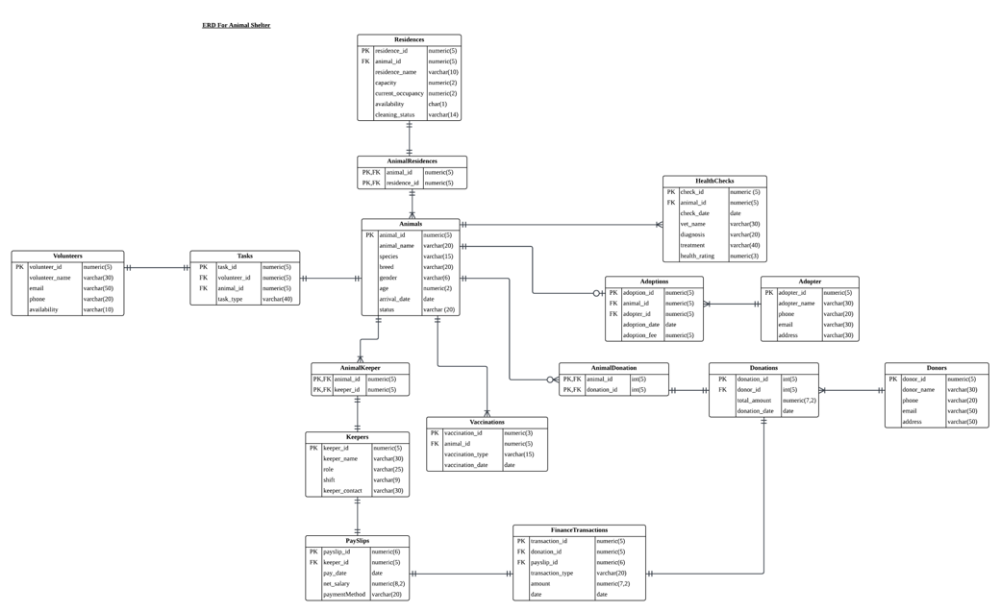

# 🐾 Wildfare Sanctuary Database

<p align="center">
  <b>A relational Oracle SQL database that manages the day-to-day operations of an animal sanctuary: animals, housing, health, adoptions, donations, volunteers, keepers and payroll.</b>
</p>

<p align="center">
  
  
  
</p>

---

## 📌 Table of Contents
* [Overview](#-overview)
* [Presentation](#-presentation)
* [Entity Relationship Diagram](#-entity-relationship-diagram)
* [Database Design](#-database-design)
  * [Table Summary](#table-summary)
  * [Relationships](#relationships)
  * [Table Details](#table-details)
* [SQL Queries](#-sql-queries)
* [Getting Started](#-getting-started)
* [Repository Structure](#-repository-structure)
* [Technical Notes](#-technical-notes)
* [Contributors](#-contributors)

---

## 🔍 Overview

This project is a database design and implementation for an **animal sanctuary** (animal shelter). It replaces scattered paper records with a normalised relational database that can answer questions such as:

* Which animals are available for adoption, and which have already been adopted?
* Where is each animal housed, and which residences need cleaning?
* What is each animal's vaccination and health-check history?
* Who donated, how much, and which animal did the money support?
* Which volunteers and keepers look after which animals?
* How much is spent on staff pay compared with money received from donations?

The single script `Wildfare_Sanctuary.sql` creates all tables and constraints, inserts sample data, and runs six demonstration queries.

---

## 🎥 Presentation

▶️ Watch the project presentation on YouTube: **[Wildfare Sanctuary Database Presentation](https://youtu.be/TOXnwoRS6AY)**

---

## 🗺 Entity Relationship Diagram



The `Animals` table sits at the centre of the design. Most other tables link back to it, either directly or through a **junction table** that resolves a many-to-many relationship.

---

## 🧱 Database Design

### Table Summary

The database has **16 tables** in five functional groups.

| Group | Tables | Purpose |
|-------|--------|---------|
| **Animal care** | `Animals`, `Residences`, `AnimalResidence`, `Vaccinations`, `HealthCheck` | Animal records, housing and medical history |
| **Adoption** | `Adopter`, `Adoption` | People who adopt and the adoption records |
| **Donations** | `Donor`, `Donation`, `AnimalDonation` | Donors, their gifts, and which animals each gift supports |
| **People & staff** | `Keepers`, `AnimalKeeper`, `Volunteers`, `Tasks` | Staff, volunteers and the work assigned to them |
| **Finance** | `PaySlip`, `FinanceTransaction` | Salary payments and a ledger of money in and out |

| Table | Sample rows | Primary key |
|-------|:----------:|-------------|
| Animals | 15 | `animal_id` |
| Residences | 9 | `residence_id` |
| AnimalResidence | 15 | `(animal_id, residence_id)` |
| Vaccinations | 20 | `vaccination_id` |
| HealthCheck | 20 | `check_id` |
| Adopter | 8 | `adopter_id` |
| Adoption | 9 | `adoption_id` |
| Donor | 8 | `donor_id` |
| Donation | 15 | `donation_id` |
| AnimalDonation | 15 | `(animal_id, donation_id)` |
| Keepers | 20 | `keep_id` |
| AnimalKeeper | 20 | `(animal_id, keeper_id)` |
| Volunteers | 15 | `volunteer_id` |
| Tasks | 15 | `task_id` |
| PaySlip | 20 | `payslip_id` |
| FinanceTransaction | 28 | `transaction_id` |

### Relationships

| Relationship | Type | Implemented by |
|--------------|:----:|----------------|
| Animals ↔ Residences | Many-to-many | `AnimalResidence` |
| Animals ↔ Keepers | Many-to-many | `AnimalKeeper` |
| Animals ↔ Volunteers | Many-to-many | `Tasks` (also stores the task type) |
| Animals ↔ Donations | Many-to-many | `AnimalDonation` (also stores `support_amount`) |
| Animals ↔ Adopters | Many-to-many | `Adoption` (also stores date and fee) |
| Animals → Vaccinations | One-to-many | `Vaccinations.animal_id` |
| Animals → HealthCheck | One-to-many | `HealthCheck.animal_id` |
| Donor → Donation | One-to-many | `Donation.donor_id` |
| Keepers → PaySlip | One-to-many | `PaySlip.keeper_id` |
| Donation → FinanceTransaction | One-to-many (optional) | `FinanceTransaction.donation_id` |
| PaySlip → FinanceTransaction | One-to-many (optional) | `FinanceTransaction.payslip_id` |

> A `FinanceTransaction` is linked to **either** a donation (money in) **or** a payslip (money out), so one of the two foreign keys is `NULL` in every row.

### Table Details

<details>
<summary><b>🐶 Animal care</b></summary>

#### Animals
| Column | Type | Constraints |
|--------|------|-------------|
| `animal_id` | NUMERIC(5) | **PK** |
| `animal_name` | VARCHAR2(20) | NOT NULL |
| `species` | VARCHAR2(15) | NOT NULL |
| `breed` | VARCHAR2(20) | NOT NULL |
| `gender` | VARCHAR2(6) | NOT NULL |
| `age` | NUMERIC(2) | NOT NULL, `CHECK (age > 0)` |
| `arrival_date` | DATE | NOT NULL |
| `status` | VARCHAR2(20) | NOT NULL (`Available`, `Adopted`, `Medical Hold`) |

#### Residences
| Column | Type | Constraints |
|--------|------|-------------|
| `residence_id` | NUMERIC(5) | **PK** |
| `residence_name` | VARCHAR2(20) | NOT NULL |
| `capacity` | NUMERIC(2) | NOT NULL |
| `current_occupancy` | NUMERIC(2) | NOT NULL |
| `availability` | CHAR(1) | NOT NULL (`Y` / `N`) |
| `cleaning_status` | VARCHAR2(14) | NOT NULL (`Clean`, `Needs Cleaning`, `In Cleaning`) |

#### AnimalResidence *(junction)*
| Column | Type | Constraints |
|--------|------|-------------|
| `animal_id` | NUMERIC(5) | **PK, FK** → Animals |
| `residence_id` | NUMERIC(5) | **PK, FK** → Residences |

#### Vaccinations
| Column | Type | Constraints |
|--------|------|-------------|
| `vaccination_id` | NUMERIC(3) | **PK** |
| `animal_id` | NUMERIC(5) | **FK** → Animals, NOT NULL |
| `vaccination_type` | VARCHAR2(15) | NOT NULL |
| `vaccination_date` | DATE | NOT NULL |

#### HealthCheck
| Column | Type | Constraints |
|--------|------|-------------|
| `check_id` | NUMERIC(5) | **PK** |
| `animal_id` | NUMERIC(5) | **FK** → Animals, NOT NULL |
| `check_date` | DATE | NOT NULL |
| `vet_name` | VARCHAR2(30) | |
| `diagnosis` | VARCHAR2(30) | |
| `treatment` | VARCHAR2(40) | |
| `health_rating` | NUMERIC(3) | `CHECK (health_rating BETWEEN 1 AND 5)` |

</details>

<details>
<summary><b>🏠 Adoption</b></summary>

#### Adopter
| Column | Type | Constraints |
|--------|------|-------------|
| `adopter_id` | NUMERIC(5) | **PK** |
| `adopter_name` | VARCHAR2(30) | NOT NULL |
| `phone` | VARCHAR2(20) | NOT NULL |
| `email` | VARCHAR2(30) | NOT NULL |
| `address` | VARCHAR2(30) | NOT NULL |

#### Adoption
| Column | Type | Constraints |
|--------|------|-------------|
| `adoption_id` | NUMERIC(5) | **PK** |
| `animal_id` | NUMERIC(5) | **FK** → Animals, NOT NULL |
| `adopter_id` | NUMERIC(5) | **FK** → Adopter, NOT NULL |
| `adoption_date` | DATE | NOT NULL |
| `adoption_fee` | NUMERIC(5) | NOT NULL |

</details>

<details>
<summary><b>💝 Donations</b></summary>

#### Donor
| Column | Type | Constraints |
|--------|------|-------------|
| `donor_id` | NUMERIC(5) | **PK** |
| `donor_name` | VARCHAR2(30) | NOT NULL |
| `phone` | VARCHAR2(20) | NOT NULL |
| `email` | VARCHAR2(50) | NOT NULL |
| `address` | VARCHAR2(50) | NOT NULL |

#### Donation
| Column | Type | Constraints |
|--------|------|-------------|
| `donation_id` | NUMERIC(5) | **PK** |
| `donor_id` | NUMERIC(5) | **FK** → Donor, NOT NULL |
| `total_amount` | NUMERIC(7,2) | NOT NULL |
| `donation_date` | DATE | NOT NULL |

#### AnimalDonation *(junction)*
| Column | Type | Constraints |
|--------|------|-------------|
| `animal_id` | NUMERIC(5) | **PK, FK** → Animals |
| `donation_id` | NUMERIC(5) | **PK, FK** → Donation |
| `support_amount` | NUMERIC(7,2) | NOT NULL |

</details>

<details>
<summary><b>👥 People & staff</b></summary>

#### Keepers
| Column | Type | Constraints |
|--------|------|-------------|
| `keep_id` | NUMERIC(5) | **PK** |
| `keeper_name` | VARCHAR2(30) | NOT NULL |
| `role` | VARCHAR2(25) | NOT NULL (Feeder, Cleaner, Medical Assistant, Vet Assistant) |
| `shift` | VARCHAR2(9) | NOT NULL (Morning, Afternoon, Evening) |
| `keeper_contact` | VARCHAR2(30) | NOT NULL |

#### AnimalKeeper *(junction)*
| Column | Type | Constraints |
|--------|------|-------------|
| `animal_id` | NUMERIC(5) | **PK, FK** → Animals |
| `keeper_id` | NUMERIC(5) | **PK, FK** → Keepers(`keep_id`) |

#### Volunteers
| Column | Type | Constraints |
|--------|------|-------------|
| `volunteer_id` | NUMERIC(5) | **PK** |
| `schedule_id` | NUMERIC(5) | NOT NULL |
| `volunteer_name` | VARCHAR2(30) | NOT NULL |
| `email` | VARCHAR2(50) | NOT NULL, **UNIQUE** |
| `phone` | VARCHAR2(20) | NOT NULL |
| `availability` | VARCHAR2(10) | NOT NULL |

#### Tasks
| Column | Type | Constraints |
|--------|------|-------------|
| `task_id` | NUMERIC(5) | **PK** |
| `volunteer_id` | NUMERIC(5) | **FK** → Volunteers, NOT NULL |
| `animal_id` | NUMERIC(5) | **FK** → Animals, NOT NULL |
| `task_type` | VARCHAR2(20) | NOT NULL (Feeding, Bathing, Grooming, Training, ...) |

</details>

<details>
<summary><b>💰 Finance</b></summary>

#### PaySlip
| Column | Type | Constraints |
|--------|------|-------------|
| `payslip_id` | NUMERIC(6) | **PK** |
| `keeper_id` | NUMERIC(5) | **FK** → Keepers(`keep_id`), NOT NULL |
| `pay_date` | DATE | NOT NULL |
| `net_salary` | NUMERIC(8,2) | `CHECK (net_salary >= 0)` |
| `paymentMethod` | VARCHAR2(20) | NOT NULL (Bank / Cash) |

#### FinanceTransaction
| Column | Type | Constraints |
|--------|------|-------------|
| `transaction_id` | NUMERIC(5) | **PK** |
| `donation_id` | NUMERIC(5) | **FK** → Donation (nullable) |
| `payslip_id` | NUMERIC(6) | **FK** → PaySlip (nullable) |
| `transaction_type` | VARCHAR2(20) | NOT NULL (`Donation` / `PaySlip`) |
| `amount` | NUMERIC(7,2) | NOT NULL |
| `transaction_date` | DATE | NOT NULL |

</details>

---

## 🔎 SQL Queries

The script ends with six queries that demonstrate different SQL techniques.

| | Requirement | What it shows | Techniques |
|:-:|-------------|---------------|------------|
| **a** | Outer join | Every animal with its adoption details, including animals **not yet adopted** (adoption columns show `NULL`) | `LEFT OUTER JOIN` ×2 |
| **b** | 4-table join with `GROUP BY` | Donation totals per **species**: number of donors, number of donations, total and average support, only where total support exceeds 200 | `INNER JOIN` ×3, `COUNT(DISTINCT)`, `SUM`, `AVG`, `GROUP BY`, `HAVING` |
| **c** | String pattern & date function | Volunteers with Gmail addresses, their tasks and animals that arrived in January 2023, plus days since arrival | `LIKE '%gmail.com'`, `SYSDATE`, `ROUND`, date range filter |
| **d** | `AND` + `OR` | Healthy (rating ≥ 4) **dogs or cats** that are still **available** for adoption | `(... OR ...) AND ...`, `ORDER BY ... DESC` |
| **e** | 2+ subqueries | Medical-assistant keepers, their salary, the animals they care for and each animal's **latest** health rating | Inline view, nested subquery with `MAX(check_date)` |
| **f** | Health-study candidates | Animals **not adopted**, in the sanctuary for **over a year**, with a perfect health rating of 5 | `ADD_MONTHS`, `SYSDATE`, `<>` |

### Example: query (a), outer join
```sql
SELECT a.animal_id, a.animal_name, a.species, a.breed, a.status,
       ad.adoption_date, adopter.adopter_name, ad.adoption_fee
FROM Animals a
LEFT OUTER JOIN Adoption ad       ON a.animal_id  = ad.animal_id
LEFT OUTER JOIN Adopter  adopter  ON ad.adopter_id = adopter.adopter_id
ORDER BY a.animal_id;
```

### Example: query (d), AND with OR
```sql
SELECT a.animal_id, a.animal_name, a.species, a.status, hc.health_rating
FROM Animals a
JOIN HealthCheck hc ON a.animal_id = hc.animal_id
WHERE (a.species = 'Dog' OR a.species = 'Cat')
  AND hc.health_rating >= 4
  AND a.status = 'Available'
ORDER BY hc.health_rating DESC;
```

---

## 🚀 Getting Started

### Requirements
* **Oracle Database** (11g or newer), including Oracle XE
* A SQL client: [Oracle SQL Developer](https://www.oracle.com/database/sqldeveloper/), SQL\*Plus, or [Oracle Live SQL](https://livesql.oracle.com/)

### Run the script

1. **Clone the repository**
   ```bash
   git clone https://github.com/<your-username>/Wildfare-Sanctuary-Database.git
   cd Wildfare-Sanctuary-Database
   ```
2. **Open** `Wildfare_Sanctuary.sql` in SQL Developer and connect to your Oracle database.
3. **Run it as a script** (`F5` in SQL Developer, **not** `Ctrl+Enter`), or from SQL\*Plus:
   ```sql
   @Wildfare_Sanctuary.sql
   ```

The script will, in order:

1. Set the date format to `DD-MON-YYYY`
2. **Drop** any existing tables (so it is safe to re-run)
3. **Create** all 16 tables with their keys and constraints
4. **Insert** the sample data
5. Display every table with `SELECT *`
6. Run the six analytical queries

> ⚠️ The script runs `DROP TABLE ... CASCADE CONSTRAINTS` on tables with these names. Run it in a schema where that's safe.

---

## 📂 Repository Structure

```text
Wildfare-Sanctuary-Database/
│
├── Wildfare_Sanctuary.sql      # Create tables, insert data, run queries
├── images/
│   └── erd.png                  # Entity Relationship Diagram
├── docs/
│   └── Database_Assignment_Group_Report.pdf   # (optional) written report
└── README.md
```

---

## ⚙️ Technical Notes

* **Primary keys** on every table; **composite keys** on the three junction tables
* **Foreign keys** enforce referential integrity across all relationships
* **CHECK constraints:** `age > 0`, `health_rating BETWEEN 1 AND 5`, `net_salary >= 0`
* **UNIQUE constraint:** volunteer `email`
* **Dates** are written as `DD-MON-YYYY` (e.g. `15-JAN-2023`)
* **Sample data** is entirely fictional
